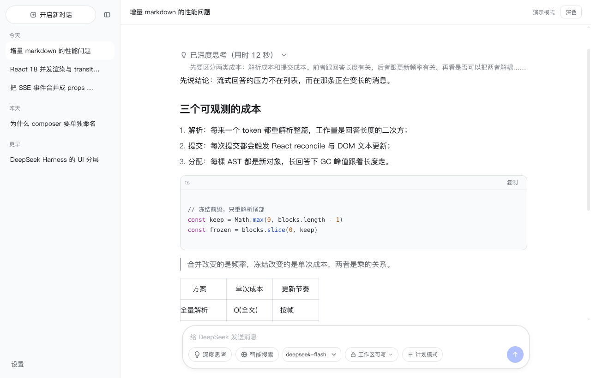

# 肥鱼design · fat-fish-design

肥鱼design——派生自 DeepSeek 官方 UI 代码的 LLM chatbot 组件库。

这个仓库把官方开源的接口、设计 token 与交互细节，收敛成一套**可复用、无状态依赖**的聊天 UI 组件库，并用它拼出一个 chat-demo 类似物。



<sub>浅色主题；深色见 [`docs/screenshot-dark.png`](docs/screenshot-dark.png)</sub>

**非官方项目**：与深度求索（DeepSeek）无关联、未获其背书。见文末[许可证与商标](#许可证与商标)。

---

## 它解决什么问题

聊天 UI 的难点不在布局，在**流式**：

- 每来一个 token 就重解析整篇 Markdown → 工作量随回答长度二次增长；
- 每来一个 token 就提交一次状态 → 掉帧、输入卡顿；
- 想优化，就得让组件知道"我现在在流式"，于是状态从 props 漏进组件内部，越写越乱。

这个仓库的做法是：**API 只暴露 `text: string`，把优化藏进渲染器**。

| | 每个 token 全量解析 | 每个 token 增量解析 |
| --- | --- | --- |
| 解析字符总量 | 615,643,606 | **4,305,589**（143× 少） |
| 解析总耗时 | 58,673 ms | **3,807 ms** |
| 端到端 | 60,851 ms | **5,640 ms** |

> 语料：74,428 字符 / 16,540 token，含 3,000 字长段落、1,200 行代码围栏、120 行表格。结算后 DOM 指纹与全量渲染完全一致。

---

## 快速开始

需要 Node 22+。

```bash
npm install
npx vite --port 5499
```

| 地址 | 内容 |
| --- | --- |
| `/` | 集成示例：侧栏 + 消息流 + 输入区 + 设置（默认演示模式，不联网） |
| `/?example` | `examples/full.tsx` 的可运行版本 |
| `/?minimal` | `examples/minimal.tsx` 的可运行版本 |
| `/?poc` | Markdown 增量解析基准页（4 个测试按钮 + 解析曲线） |

设置里填入 API Key 并打开「使用真实 API」即可直连 `api.deepseek.com`（浏览器直连，无后端）。

```bash
npx tsc --noEmit   # 类型检查（包含 examples/ 两个文件）
npx vite build     # 产物约 351 KB JS / 66 KB CSS（gzip 113 KB / 11 KB）
```

---

## 目录

```
src/
  ui/
    atoms/          Button IconButton Tag Pill Switch Checkbox Tooltip Menu Modal Select
    toast/          ToastProvider / useToast（实例级队列）
    empty/          EmptyState
  chat/
    message/        MessageItem / ThinkingBlock / BranchSwitcher
    composer/       PromptInput / Composer（IME、自适应高度、拖拽、粘贴、附件、语音、自定义开关）
    list/           MessageList（滚动闩锁 + followSignal）
    sider/          Sider / SessionItem（分组、重命名、删除确认）
  markdown/         MarkdownText / incremental / render / CodeBlock / highlight
  chat-protocol/    types.ts + labels.ts（zh / en）
  tokens/           设计 token：theme / extra / global
  app/              ChatDemo + transport（真实 SSE）+ feed（token 合并）+ settings
  bench/            Markdown 基准页（?poc）
examples/           minimal.tsx / full.tsx（随 tsc 校验）
docs/               api.md / example.md / contract.md / 截图
```

---

## 四条设计原则

1. **props 是唯一真相**
   组件不订阅 store、不做请求、不写存储。会话、消息、草稿、附件全在调用方。

2. **文案全部外部注入**
   组件内没有任何中英文字面量，全部来自 `labels`（`zh` / `en` 已提供，可局部覆盖）。

3. **副作用走端口**
   语音、打开附件、复制通过 `SpeechPort` / `onOpenAttachment` / `onCopy` 注入；不传就不渲染对应功能。

4. **增长型文本用派生缓存**
   `MarkdownText` 的缓存是 `text` 的纯函数派生结果：命中就用、失效就重算，结果与全量解析逐字节一致。所以它不构成"第二真相"，也不需要 `addToken` 这类命令式接口。

### 流式渲染的三层

```
SSE 事件 100/s
  ↓  调用方合并（rAF / 30Hz）           ← 频率
React render（只动最后一条消息）        ← memo
  ↓  冻结前缀 + 尾块重解析               ← 单次成本
paint
```

三者互不替代：合并减少次数，缓存降低成本，memo 减少范围。

---

## 组件清单

| 分类 | 组件 |
| --- | --- |
| 原子控件 | `Button` `IconButton` `Tag` `Pill` `Switch` `Checkbox` `Tooltip` `Menu` `Modal` `Select` |
| 提示 | `ToastProvider` `useToast` `EmptyState` |
| 消息 | `MessageItem` `ThinkingBlock` `BranchSwitcher` |
| 输入 | `Composer` `PromptInput` |
| 列表 | `MessageList` |
| 侧栏 | `Sider` `SessionItem` |
| 输入区座位 | `PermissionSelect` `PlanToggle` `ActivityIndicator` |
| Markdown | `MarkdownText` |

完整签名、行为与常见坑见 [`docs/api.md`](docs/api.md)。

---

## 接真后端

只需要替换 transport，组件一行不改。`src/app/transport.ts` 已实现：

```ts
const transport = createTransport({ apiKey, model: 'deepseek-flash' })
for await (const event of transport.send({ text, thinking, search, history })) {
  // text-delta / thinking-delta / search-results / title / usage / done / error
}
```

它负责 `POST /anthropic/v1/messages`、SSE 分包解析（不规则分块、`\r\n`、`:keep-alive`）、
事件翻译、HTTP 错误分类（429/5xx 标 `retryable`）与 `abort()`。

调用方剩下的活就是：把事件写进自己的消息数组（`docs/example.md` 有一段 30 行的参考实现）。

### 尚未实现

- 持久化（IndexedDB）：刷新即丢；
- 附件上传（`/anthropic/v1/files` 换 `file_id`）：目前只做展示；
- 引用角标的悬浮来源卡（现为一行链接）；
- 分支的父子链模型（组件支持，示例数据未用）；
- 移动端抽屉与虚拟列表。

---

## 文档

| 文档 | 内容 |
| --- | --- |
| [`docs/api.md`](docs/api.md) | 组件 API 参考：签名、默认值、无障碍行为、性能契约、9 条常见坑 |
| [`docs/example.md`](docs/example.md) | 最小示例、完整示例、接真后端要改的三处 |
| [`docs/contract.md`](docs/contract.md) | 早期冻结的类型/文案/目录契约（历史快照） |
| [`THIRD_PARTY_NOTICES.md`](THIRD_PARTY_NOTICES.md) | 派生了哪些官方代码、第三方依赖清单 |

---

## 许可证与商标

代码以 [MIT](LICENSE) 发布，Copyright (c) 2026 fat-fish-design contributors。

设计 token（`src/tokens/theme.css`、`global.css`）与部分交互细节派生自 DeepSeek 的 MIT 开源仓库
（[`deepseek-ai/chat-demo`](https://github.com/deepseek-ai/chat-demo)、
[`deepseek-ai/deepseek-harness`](https://github.com/deepseek-ai/deepseek-harness)），
两者均为 MIT，Copyright (c) 2026 DeepSeek。具体清单见 [`THIRD_PARTY_NOTICES.md`](THIRD_PARTY_NOTICES.md)。

"DeepSeek"、"深度求索" 及其标识是 DeepSeek 的商标。本项目是**非官方**项目，与 DeepSeek 无关联，
也未获其认可或授权。仓库中的 `--dsw-*` 变量名、DeepSeek 色阶仅作为设计 token 的实现细节；
如需对外发布衍生作品，建议先自行重命名并移除品牌资源。
